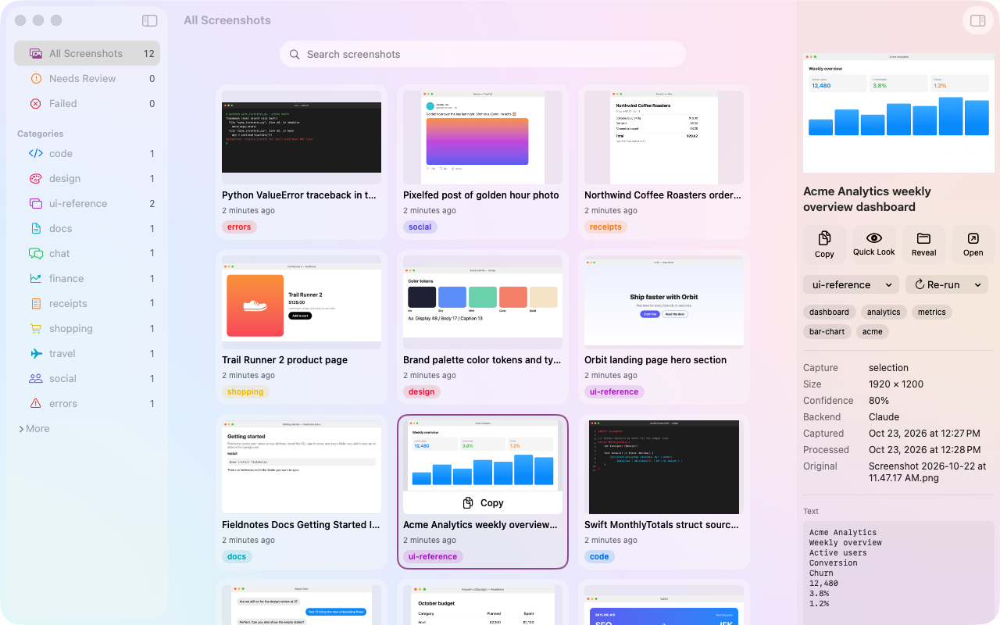
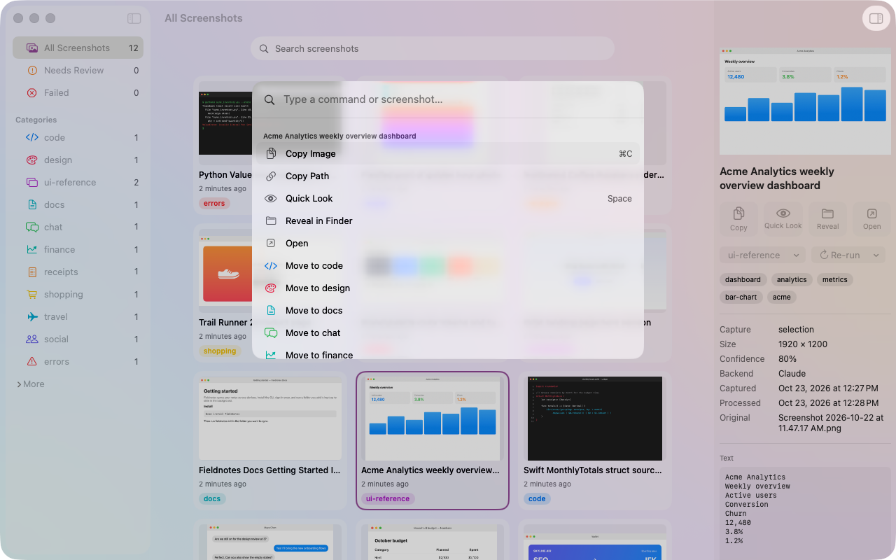

# Shots

**Your screenshots, filed for you.** Shots is a macOS menu bar app that watches where your screenshots land, reads them on-device, works out what each one is, and files it: renamed, moved into a category folder, tagged in Finder, and searchable by the text inside it.



- **Automatic filing.** A screenshot of a stack trace lands in `errors/`, a receipt in `receipts/`, a boarding pass in `travel/`, each named like `2026-10-22_0914_skyline-air-boarding-pass-sfo-to-jfk.png`.
- **Search by what's in them.** Text is read with Apple's Vision framework, so you can find a screenshot by any word it contains, or by the app, window or web page it came from.
- **On-device first.** Classification starts with Apple's on-device model. Claude Code and Codex can step in for a second opinion, but never for screenshots of apps or sites you exclude.
- **Instant copy.** Each new screenshot is on your clipboard within about half a second, with a small preview in the corner that shows where it was filed.

## Requirements

- macOS 26 or later, with Apple Intelligence turned on (for on-device classification)
- Xcode with the macOS 27 SDK, to build
- Optional: the [Claude Code](https://claude.com/claude-code) and/or [Codex](https://developers.openai.com/codex) CLIs, signed in, for cloud classification

## Install

Shots is built from source.

```bash
git clone <this repo> shots
```

```bash
cd shots && scripts/install.sh
```

This builds `Shots.app`, installs it to `/Applications`, links the `shots` command-line tool to `~/.local/bin/shots`, and opens the app. On first launch it offers to start at login.

Then send new screenshots to Shots' inbox, and turn off the macOS floating thumbnail (Shots shows its own preview; the system thumbnail delays the file by about 5 seconds):

```bash
defaults write com.apple.screencapture location ~/Screenshots/_inbox
```

```bash
defaults write com.apple.screencapture show-thumbnail -bool false
```

Finally, grant **Accessibility** to Shots (see [Permissions](#permissions)) so it can record the window each screenshot came from. Check everything with:

```bash
shots doctor
```

To uninstall, run `scripts/uninstall.sh`. It removes the app and the `shots` link, and leaves your screenshots, config and index alone.

## Using Shots

Take screenshots as usual. Each one is copied to your clipboard right away, then classified and moved to `~/Screenshots/<category>/`. A preview in the bottom-right corner shows the result, with a menu to change the category; turn it off with **Show Preview After Capture** in the menu bar menu.

Open the window from the menu bar icon to browse:

- **Sidebar:** All, Needs Review (screenshots Shots wasn't sure about), Failed, and your categories. Empty categories fold under More.
- **Grid:** newest first, with full-text search. Hover a card to copy it.
- **Inspector:** a larger preview, Copy / Quick Look / Reveal / Open, the category and Re-run menus, tags, where it came from, and the recognized text.



| Key | Action |
|---|---|
| ⌘K | Command palette: act on the selection, jump anywhere, or find any screenshot |
| ⌘F | Search (↓ or Return to the results, Esc to clear) |
| Arrow keys | Move through the grid |
| Space / Return | Quick Look / open |
| ⌘C | Copy the image |
| ⌘1–⌘9 | Jump to a sidebar item |
| ⌥⌘I | Show or hide the inspector |

Shots keeps running in the menu bar when you close the window, and leaves the Dock. Quit it from the menu bar menu.

## Permissions

All permissions belong to Shots.app. **Status & Permissions** (⌘, or the menu bar menu) shows what's granted and opens the right System Settings pane.

| Permission | Used for | Without it |
|---|---|---|
| **Accessibility** | The title of the window you were in | Shots still knows the app, just not the window |
| **Automation** (asked per browser, on first use) | The URL and title of the browser tab (Safari and Chromium-based browsers) | No URL |
| Screen Recording (optional) | Window titles when Accessibility is off | No window title |

Full Disk Access isn't needed as long as your inbox and screenshot folders are outside Desktop, Documents and Downloads. If the menu bar icon is missing, check System Settings → Menu Bar.

## How classification works

Shots asks a chain of classifiers, in order, for a category, a short title, tags and a confidence score. Each gets the recognized text, the app, window and URL the screenshot came from, and your list of categories.

| Classifier | Runs | Notes |
|---|---|---|
| **apple** | On-device (Foundation Models) | Text only on macOS 26; also sees the image on macOS 27 |
| **claude-code** | Claude Code CLI | Runs in an empty temporary folder, can read only the one image, uses your existing login |
| **codex** | Codex CLI | Read-only sandbox, image attached, uses your existing login |
| **rules** | On-device | Maps apps to categories and spots keywords; a last resort |

If a classifier fails, times out, or is less confident than `escalateBelowConfidence`, the next one gets a turn. If the best answer is still unsure, or names a category you don't have, the screenshot goes to `misc` and shows up under **Needs Review** with the suggestion, ready to accept with one click. If every classifier fails, the screenshot stays in the inbox and is retried later.

> **Tip:** on macOS 26, Apple's model reports high confidence even when it's guessing. Set `"confidenceCap": {"apple": 0.55}` so a cloud classifier always double-checks, or put a cloud classifier first.

## Privacy

- Text recognition always runs on your Mac. So do the **apple** and **rules** classifiers.
- Set `"allowCloud": false` to never use Claude Code or Codex.
- Screenshots of apps in `cloudDenylist` (password managers are listed by default), or of browser tabs on domains in `cloudDenylistDomains` (for example your bank), never leave your Mac. They use on-device classification only.
- Shots never deletes a screenshot. Moves refuse to overwrite, and a screenshot that can't be classified stays where it was.

## Configuration

Settings live in `~/.config/shots/config.json`, created with defaults on first run. **Reload Config** in Status & Permissions applies changes.

```jsonc
{
  "inbox": "~/Screenshots/_inbox",
  "outputRoot": "~/Screenshots",
  "categories": ["code", "design", "ui-reference", "docs", "chat", "finance", "receipts", "shopping", "travel", "social", "errors", "misc"],
  "categoryHints": { "code": "source code, terminals, diffs, …" },   // one line per category, shown to the classifiers
  "backends": ["apple", "claude-code", "codex"],                       // the classifier chain, in order
  "escalateBelowConfidence": 0.6,
  "reviewBelowConfidence": 0.6,
  "confidenceCap": {},
  "allowCloud": true,
  "cloudDenylist": ["com.1password.1password", "…"],
  "cloudDenylistDomains": [],
  "copyToClipboard": true,
  "timeoutMs": 30000,
  "claudeCode": { "binary": "claude", "model": "sonnet", "effort": "low" },
  "codex": { "binary": "codex", "model": "gpt-6-luna", "effort": "low" }  // use a model your account can run
}
```

The index of filed screenshots is a SQLite database at `~/.local/share/shots/shots.db`, and logs go to `~/Library/Logs/shots/shots.log`.

## Command line

```
shots search <query> [--limit N] [--json]   search screenshots by their text, title, tags, app or URL
shots recat <file> [--category <name>]      move a screenshot to another category
shots recat <file> --backend <name>         classify it again with apple, claude-code, codex or rules
shots review [--failed]                     list screenshots that need review, or failed ones
shots doctor                                check models, CLIs, permissions and config
shots config [--json]                       print the active configuration
```

`recat` keeps any Finder tags you added yourself, and refuses to send a screenshot from an excluded app to a cloud classifier.

## How it works

```
new file in the inbox ─▶ note the app/window/tab ─▶ wait until fully written ─▶ is it a screenshot?
                      ─▶ copy to clipboard ─▶ read text (Vision) ─▶ classify (apple → claude-code → codex)
                      ─▶ rename, move, tag in Finder ─▶ add to the search index
```

Everything is one Swift package in `app/`:

| Target | Contents |
|---|---|
| `ShotsCore` | Config, the SQLite index, file handling, the classifier chain and backends, the pipeline and the inbox watcher (Foundation, SQLite3 and CryptoKit only) |
| `ShotsNative` | The macOS side: Vision text recognition, app/window/tab context, screenshot metadata, Finder tags, clipboard, Foundation Models |
| `ShotsKit` | View models and the controller that runs the watcher inside the app |
| `Shots` | The SwiftUI app: window, Status & Permissions, menu bar extra, capture preview |
| `ShotsCommand` | The `shots` command-line tool, shipped inside the app bundle |

A few macOS details shaped the design:

| macOS behavior | What Shots does |
|---|---|
| `mdls` knows nothing about a new screenshot until Spotlight indexes it | Reads the screenshot flags from the file's extended attributes, which are there immediately |
| Screenshots are written to a hidden temporary file, then renamed | Rescans the inbox on any change instead of trusting event file names |
| The on-device model has a 4,096-token context | Trims long text before asking it |
| An app started from Finder gets a minimal `PATH` | Looks for `claude` and `codex` in the usual install locations too |

The index tracks every file it has seen, so restarts are safe: interrupted work resumes, duplicates are skipped, and nothing is processed twice.

## Development

Open `app/Package.swift` in Xcode; every view has a SwiftUI preview. From a terminal:

```bash
swift build --package-path app
```

```bash
swift test --package-path app
```

```bash
scripts/build-app.sh --install
```

**Signing.** `scripts/build-app.sh` signs with your first "Apple Development" certificate and falls back to ad-hoc signing. With ad-hoc signing, macOS forgets Shots' permissions on every rebuild. A free development certificate fixes that: Xcode → Settings → Accounts → sign in with your Apple ID → Manage Certificates → `+` → Apple Development.

**Tests.** The test suite covers the classifier chain, privacy rules, retries and timeouts, filing and deduplication, and the watcher, using mock classifiers and fake CLIs. Integration tests run the real text recognition, metadata and Finder tag code.

**UI smoke test.** `scripts/ui-smoke` drives the installed app with real keystrokes and clicks through [cua-driver](https://github.com/trycua/cua) (search, ⌘K, ⌘F, Esc). It changes no data, but it uses the keyboard and mouse, so leave the computer alone for a minute while it runs.

**Demo library.** `scripts/demo/seed-inbox.sh <dir>` renders a dozen made-up screenshots (a code editor, a receipt, a boarding pass…) into a folder as real screen captures. Point a test copy of Shots at that folder to get a library with no personal data; the images in this README were made that way.

**App icon.** Drawn in code by `app/Resources/make-icon.swift`.

## License

Not yet chosen.
